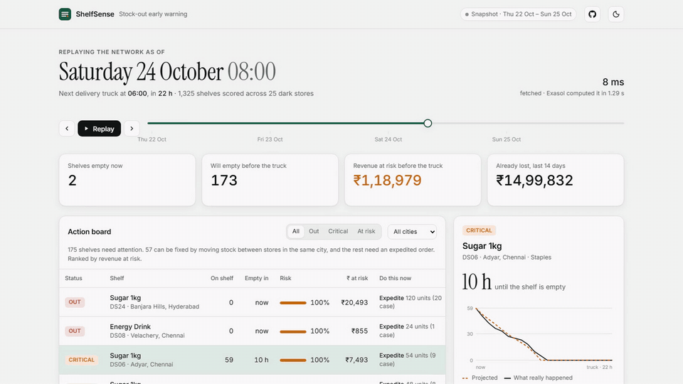
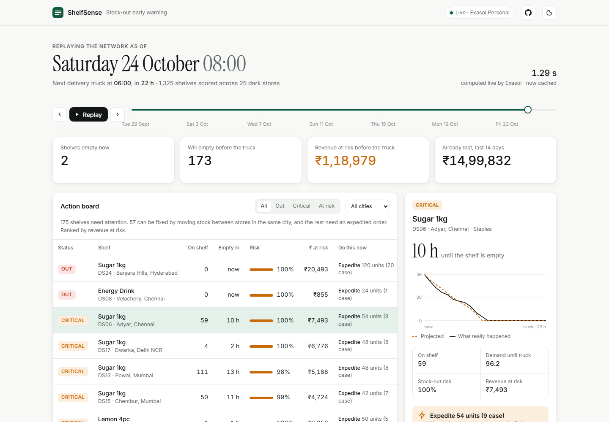

<p align="center">
  
</p>

<h1 align="center">ShelfSense</h1>

<p align="center"><b>Catch stock-outs before they happen.</b><br>
Stock-out early warning for quick-commerce dark stores, computed entirely in SQL inside <b>Exasol Personal</b>.</p>

<p align="center">
  <a href="https://shelfsense-exathon.vercel.app"></a>
  <a href="https://shelfsense-exathon.vercel.app/demo.mp4"></a>
  <a href="https://shelfsense-exathon.vercel.app/pitch.pdf"></a>
  <a href="https://github.com/andringodson/shelfsense/raw/main/docs/ShelfSense-pitch.pptx"></a>
</p>

<p align="center">
  
  
  
  
</p>

<p align="center">
  <a href="https://shelfsense-exathon.vercel.app/demo.mp4"></a><br>
  <sub>▶ Click for the full 35-second demo video · <a href="https://shelfsense-exathon.vercel.app">try it live</a></sub>
</p>

**Quick links:** [🌐 Live dashboard](https://shelfsense-exathon.vercel.app) · [📹 Demo video](https://shelfsense-exathon.vercel.app/demo.mp4) · [📊 Deck (PDF)](https://shelfsense-exathon.vercel.app/pitch.pdf) · [📎 Deck (PPTX)](https://github.com/andringodson/shelfsense/raw/main/docs/ShelfSense-pitch.pptx) · [⚙️ Setup](#setup-and-run) · [🧠 How it works](#why-exasol) · [📈 Results](#results-simulated-network-replay-at-sat-24-oct-2026-0800)

---

ShelfSense scores every shelf in every store each hour. It predicts which ones will run empty before the next delivery truck, and says what to do about each one: move stock from a nearby store or expedite an order. It also measures the revenue already lost to empty shelves, which sales reports cannot show.



## The problem

In 10-minute delivery, an empty shelf is a lost order: the customer just opens another app.
But **stock-outs are invisible in the data retailers already have**:

- Sales data records what was *sold*, not what customers *wanted*. An empty shelf at 7 PM looks
  exactly like a quiet hour.
- Forecasts trained on those sales learn that "nobody buys milk at 7 PM", so the next order is
  even smaller. Each stock-out makes the next one more likely.
- Store managers find out after the fact, from complaints or from a weekly report. By then the
  shelf has been empty for hours.

**Who has it:** dark-store managers and city ops teams at quick-commerce and grocery chains,
along with their suppliers.
**Why it matters:** each missed order costs revenue and pushes the customer toward a competitor.
On our simulated network of 25 stores, **~5.7 % of all demand goes unserved** because the shelf was empty.

## What ShelfSense does

| | |
|---|---|
| 🚨 **Action board** | Every store × product scored for *P(empty before the 06:00 truck)*, with hours until empty, ₹ at risk, and a concrete fix: *"Transfer 14 from DS03 (Indiranagar)"* or *"Expedite 24 units (2 cases)"*. |
| 📉 **Lost sales** | Estimates the demand hidden behind every empty-shelf hour and values it in ₹, by day and category. |
| ⏯️ **Live replay** | Scrub a timeline or press *Replay* to watch the network hour by hour. KPIs count, rows re-rank in place, and bars glide. |
| 🎯 **Backtest** | ShelfSense sees only data up to the replay hour, then its calls are scored against what actually happened (precision, recall, calibration). |
| 🔍 **Shelf detail** | For any shelf, the projected stock until the truck drawn against what really happened, plus the recommended fix. |

## Why Exasol

All the analytics are SQL views. Python only loads the data and serves JSON.
Each time the dashboard changes the replay moment, Exasol recomputes the whole pipeline over
**1.3 M hourly rows**:

1. **Censoring-aware demand model** (`V_SHAPE`, `V_RATE`). Weekday × hour demand curves per category
   and a 14-day rate per store × SKU are learned only from hours when the shelf was *not* empty.
   This avoids the usual trap of training forecasts on stock-out zeros.
2. **48-hour forecast** (`V_FORECAST`). Rate × shape for every shelf over a generated horizon.
3. **Stock-out risk** (`V_RISK`). Running window sums give *hours until empty*. A Poisson model
   (normal approximation) gives *P(empty before truck)*, ₹ at risk, units needed for 95 % service,
   and the spare stock each store can give away.
4. **Rebalancing** (`V_ACTIONS`). A same-city self-join with `ROW_NUMBER()` picks the best donor store,
   and falls back to an expedited case-pack order when no store can spare enough.
5. **Backtest and lost sales** (`V_BACKTEST`, `V_LOST_SALES`). Predictions are joined against the future to score them.

The dashboard shows Exasol's compute time live. The full pipeline (scoring 1,325 shelves, rebalancing, trajectories, backtest and lost sales) takes **~1.2 s** in 3 queries on a laptop, with Exasol Personal in a Podman container on Windows.

**Latency budget.** Results stream over pyexasol's websocket `execute()` rather than `export_to_pandas`, which saved ~1 s of HTTP-tunnel setup per query. The local server caches each hour, the page prefetches neighbouring hours, and the hosted site preloads every hour in the background. Stepping or replaying therefore re-renders in **~20 ms**, and a cached hour is served in **~3 ms** locally.
Because the logic lives in views, an analyst can query it directly from any SQL client:

```sql
SELECT STORE_ID, SKU_NAME, STOCK, ROUND(RISK_PROB, 2) AS RISK, RECOMMENDATION
FROM SHELFSENSE.V_ACTIONS
WHERE RISK_STATUS <> 'OK'
ORDER BY REVENUE_AT_RISK DESC
LIMIT 10;

UPDATE SHELFSENSE.APP_STATE SET AS_OF = '2026-10-20 18:00:00';  -- time-travel: every view follows
```

## Results (simulated network, replay at Sat 24 Oct 2026 08:00)

| | |
|---|---|
| Shelves scored | 1,325 (25 stores × 53 SKUs) over 1.3 M hourly rows |
| Flagged to run out before the truck | 173, with ₹1.19 lakh revenue at risk |
| Fixable by a same-city transfer | 57 of 175 (the rest get an expedited case-pack order) |
| **Backtest precision / recall** | **72 % / 57 %** of the 218 stock-outs that really happened |
| Calibration | Shelves given 85–100 % risk ran out 96 % of the time; shelves given 0–10 % ran out 4 % of the time |
| Lost-sales estimate vs ground truth | 12.2 k vs 17.0 k units (−28 %): conservative, because it uses expected rather than peak demand |

Live site: **https://shelfsense-exathon.vercel.app**. It replays 96 pre-computed hours (22–25 Oct) exported by `export_site.py`. Run `server.py` locally for every hour, computed live.

## Architecture

```
generate_data.py ──CSV──▶ load.py ──IMPORT──▶ Exasol Personal (schema SHELFSENSE)
                                                 │ tables: STORES, SKUS, SALES_HOURLY, RECEIPTS
                                                 │ views : V_HOURLY → V_SHAPE → V_RATE → V_FORECAST
                                                 │         → V_RISK → V_ACTIONS → V_BACKTEST, V_LOST_SALES
                         shelfsense_db.snapshot()◀┘ 3 queries per hour → JSON
                           ├── server.py      local: any hour, live, cached in memory
                           └── export_site.py site/snap/*.json → Vercel (static)
site/index.html  one dependency-free page for both, served at /snap/<YYYYMMDDHH>.json
```

## Setup and run

**Requirements:** Python 3.10+. Exasol Personal needs macOS (Apple Silicon), Linux, or
Windows 10+ (x64, with WSL2 and winget).

```bash
# 1. Exasol Personal
curl https://downloads.exasol.com/exasol-personal/installer.sh | sh     # macOS / Linux
#    Windows: download https://x-up.s3.eu-west-1.amazonaws.com/releases/exasol-personal/windows/x86_64/latest/exasol.exe
exasol install local          # installs Podman if needed, then starts Exasol on localhost:8563 (sys / exasol)
exasol info                   # shows the connection details

# 2. ShelfSense
git clone https://github.com/andringodson/shelfsense && cd shelfsense
pip install -r requirements.txt
python generate_data.py       # ~7 s, writes data/ (1.3 M rows, deterministic seed)
python load.py                # creates schema SHELFSENSE, bulk-loads, builds views
python server.py              # http://localhost:8000: the dashboard, every hour live from Exasol

python export_site.py         # optional: pre-compute 22–25 Oct into site/snap/ for static hosting
cd site && vercel deploy      # optional: the static site needs no database
```

If your deployment differs from the defaults, set `EXA_DSN`, `EXA_USER` and `EXA_PASSWORD` (values from `exasol info`).

**Tests:** `python -m pytest`. These check that the simulator conserves stock and that every censored hour has an empty shelf.

## Data sources and licence

- **All data is synthetic**, generated by `generate_data.py` with a fixed seed. It contains no real company,
  customer or employer data. Store names are Indian city neighbourhoods. Products, prices, demand curves,
  supplier failures and promo spikes are invented to resemble quick-commerce dark-store operations.
- `TRUTH_DEMAND` holds the simulator's hidden true demand. It is used **only** to validate the lost-sales estimate
  and is never used by the forecasting views.
- Code and data are released under the **MIT License** (see `LICENSE`).

## APIs and third-party tools

| Tool | Use | Licence |
|---|---|---|
| [Exasol Personal](https://www.exasol.com/personal) | Database: all analytics | Free personal edition |
| [Podman](https://podman.io) | Container runtime Exasol uses locally | Apache 2.0 |
| [pyexasol](https://github.com/exasol/pyexasol) | Python driver, bulk import and export | MIT |
| [NumPy](https://numpy.org) | Synthetic data generation | BSD-3 |
| [Inter](https://rsms.me/inter/), [Instrument Serif](https://fonts.google.com/specimen/Instrument+Serif) via Google Fonts | Dashboard typography | OFL 1.1 |
| [Vercel](https://vercel.com) | Static hosting of the snapshot site | n/a |
| Claude (Anthropic) | AI coding assistant during development | n/a |

No external APIs are called at runtime. The dashboard is plain HTML, CSS and JavaScript with no frameworks.

## Team

| Member | Role |
|---|---|
| **Andrin Godson** | Lead: problem framing, data model, Exasol SQL analytics, dashboard |
| **Karthikeyan** | Testing and review: reproducibility runs of the setup guide, demo scenario review |

## Demo

| | |
|---|---|
| 📹 **Demo video** (35 s, captured from the real dashboard) | [Watch in browser](https://shelfsense-exathon.vercel.app/demo.mp4) · [file in repo](brag-output/brag.mp4) |
| 📊 **Pitch deck** | [PDF in browser](https://shelfsense-exathon.vercel.app/pitch.pdf) · [PDF](docs/ShelfSense-pitch.pdf) · [PPTX](docs/ShelfSense-pitch.pptx) |
| 🌐 **Live dashboard** | [shelfsense-exathon.vercel.app](https://shelfsense-exathon.vercel.app) |
